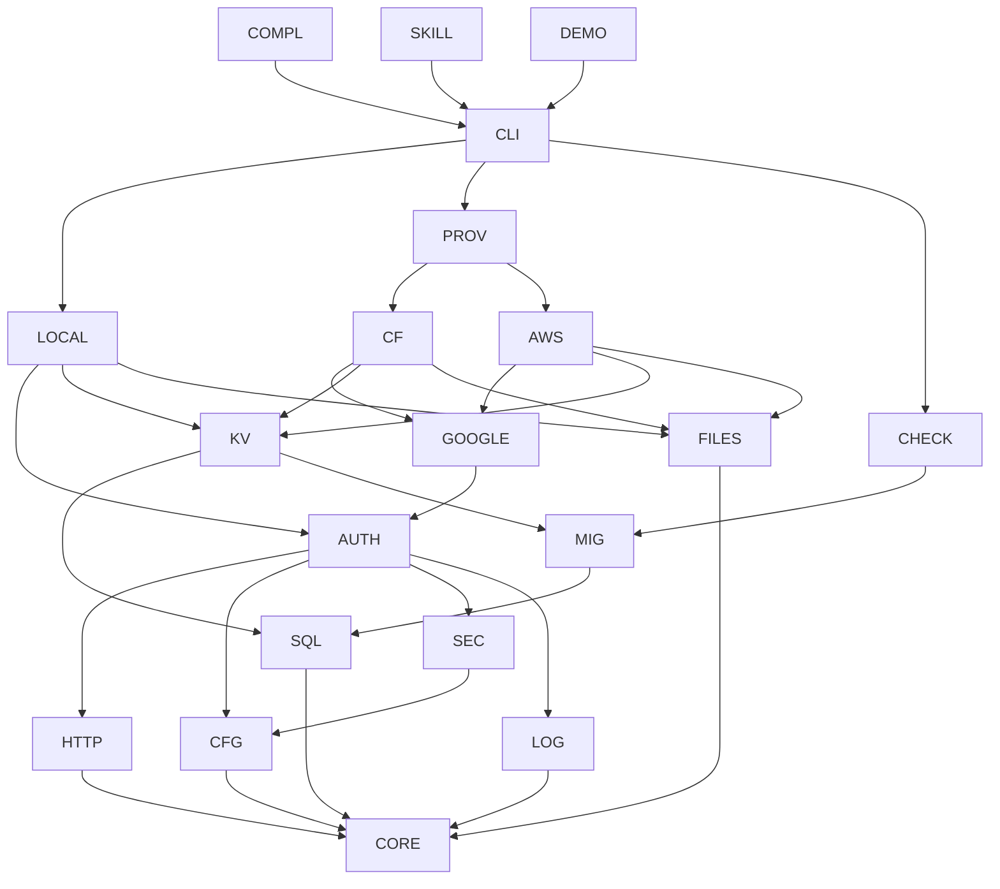

# Component Map

This document defines the framework's components, what each is responsible for, which components it depends on, and the order in which they can be built and verified. Component codes are durable identifiers (see [CONVENTIONS.md](../CONVENTIONS.md)).

## 1. Organization

Each **capability** component (SQL, KV, FILES, …) owns its portable contract and contains its adapters, one section per target. Each **target** component (LOCAL, CF, AWS) owns that runtime's entry points, wiring of the capability adapters, bundling rules, and platform constraints. Adding a target therefore means a new target component plus a new adapter section in each capability, without changing capability contracts (SYS-REQ-003).

A dependency means "uses the contract of". A component may use only the contracts of the components it lists.

## 2. Components

### Foundation

| Code | Name | Responsibility | Depends on |
| --- | --- | --- | --- |
| `CORE` | App contract | The `Services` interface and named context shapes passed to app code; app definition and entry contract; deployment identity (app, stage, target); structure of the framework error catalogue; the framework's public export list. | — |
| `HTTP` | HTTP and hosting | API routing conventions, request and response handling, HTTP error envelope, request size limits, serving the browser client from the same deployment as the API, and the browser-side helper for calling the API. | CORE |

### Capabilities

| Code | Name | Responsibility | Depends on |
| --- | --- | --- | --- |
| `SQL` | Portable SQL | Portable schema definition, the supported query subset, the atomic multi-write helper, and normalization of behavior across databases. | CORE |
| `MIG` | Migrations | Generating, checking, and applying schema migrations on each target; migration ledger; schema readiness. | SQL |
| `KV` | Key-value | The KV capability. | CORE, SQL, MIG |
| `FILES` | Files | The files capability. | CORE |
| `CFG` | Configuration | Config declaration, per-stage values, deploy-time resolution, secret references, admin list. | CORE |
| `SEC` | Secrets | The secrets capability. | CORE, CFG |
| `LOG` | Log | The write-only log capability and the shared per-account log bucket layout. | CORE |
| `AUTH` | Current user | Access levels, opaque user IDs, sessions, login/logout and "who am I" routes, request forgery protection, the login-provider interface, and the authentication mock. | CORE, HTTP, CFG, SEC, LOG |
| `GOOGLE` | Google login provider | Google adapter behind the AUTH provider interface; certified separately (SYS-REQ-027). | AUTH, CFG, SEC |

### Targets

| Code | Name | Responsibility | Depends on |
| --- | --- | --- | --- |
| `LOCAL` | Local target | Local entry points and wiring of local adapters; local-only authentication mode. | CORE, HTTP, SQL, MIG, KV, FILES, CFG, SEC, LOG, AUTH |
| `CF` | Cloudflare target | Cloudflare entry points, wiring, bundle rules, platform constraints. | CORE, HTTP, SQL, MIG, KV, FILES, CFG, SEC, LOG, AUTH, GOOGLE |
| `AWS` | AWS target | AWS entry points, wiring, bundle rules, platform constraints. | CORE, HTTP, SQL, MIG, KV, FILES, CFG, SEC, LOG, AUTH, GOOGLE |

### Tooling and delivery

| Code | Name | Responsibility | Depends on |
| --- | --- | --- | --- |
| `PROV` | Provisioning | Target-neutral resource declaration, per-target provisioners, deploy and remove, stage isolation, one-time setup of the shared log bucket. | CORE, CFG, SEC, MIG, LOG, CF, AWS |
| `CHECK` | Static checks | Portability rules for app code, type-safety restrictions, migration checker. | CORE, SQL, MIG |
| `CLI` | Developer commands | `dev`, `check`, `build`, `deploy`, `remove`. | LOCAL, PROV, MIG, CHECK |
| `COMPL` | Compliance suite | One contract test suite and reference app run identically on all targets; evidence recording. | All capability components, LOCAL, CF, AWS, CLI |
| `SKILL` | AI skill and template | Guidance for app-building agents, app template, scaffolder. | CORE, CHECK, CLI, and the contracts of all capability components |
| `DEMO` | Demo app | Demo application, specified in `docs/demo/`. Uses only the framework's public exports. | CORE, CLI |

## 3. Dependency graph

The graph shows the edges needed to read the build order; the tables above are the complete dependency lists.

## 4. Build order

Each layer can be implemented and verified once the layers before it pass their acceptance criteria. Layers 0–4 need no cloud account.

| Layer | Components | Milestone |
| --- | --- | --- |
| 0 | CORE | Contracts compile; export list fixed. |
| 1 | HTTP, SQL, FILES, CFG, LOG | Each capability passes its local acceptance criteria. |
| 2 | MIG, SEC | Migrations apply locally on both SQL dialects. |
| 3 | KV, AUTH (with mock), CHECK | Portability checks reject their failing fixtures. |
| 4 | LOCAL | A minimal app runs and passes `check` locally. |
| 5 | GOOGLE, CF, AWS | Each target runs the minimal app. |
| 6 | PROV, CLI | Deploy and remove work on both clouds. |
| 7 | COMPL, SKILL, DEMO | Compliance suite passes on all targets; demo runs everywhere. |

CLI's `dev` and `check` commands depend only on LOCAL and CHECK and may be delivered in layer 4; `deploy` and `remove` follow in layer 6.
