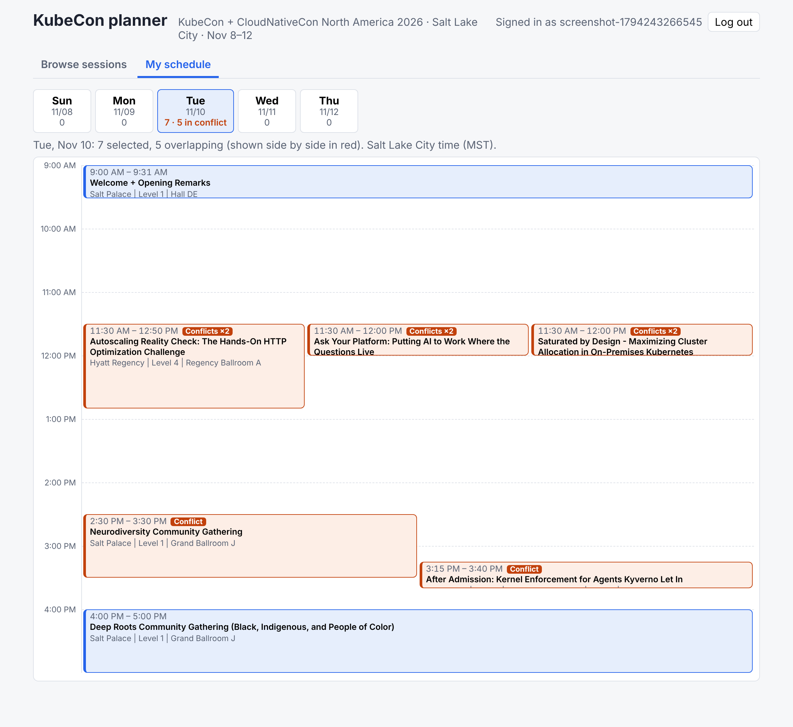

# KubeCon planner

A personal planner for **KubeCon + CloudNativeCon North America 2026** (Salt Lake City, Sunday 8 to Thursday 12 November 2026), built on the prototype framework (`@lago-morph/prototype-framework` 0.2.0-rc01) to run on Cloudflare.

- **Ingests the schedule** from the public Sessionize feeds behind the official schedule pages: the main conference, the CNCF-hosted co-located events (the Monday talks), and the CNCF Maintainer Summit (Sunday). That is about 850 sessions.
- **Browse** sessions by day. Search title, speaker and company, and filter by day, track or type, and co-located event. Open any session for its description, speakers and room, and add it to or remove it from **My schedule**.
- **Saves your selections** per signed-in user, including ones whose times overlap.
- **My schedule** has one tab per day, Sun to Thu. Each tab draws your sessions on a vertical time grid, sized by duration. Overlapping sessions sit side by side, are drawn in red and are labelled "Conflict".



All times are **Salt Lake City local time** (America/Denver, MST, UTC-07:00 in November). Sessionize publishes them as wall-clock times without an offset. The app stores and shows them exactly as published and never converts them to the browser's time zone.

## Run it locally

You need Node 22, and npm (any recent version) for `npm ci`.

```sh
cd kubecon-planner
npm ci                  # installs from package-lock.json, including the vendored framework in vendor/
npm run dev             # prints http://localhost:<port>/ ; use exactly "localhost"
```

1. Open the printed address and press **Log in**. Locally this signs you in as the mock user.
2. On first load the schedule table is empty, so the page imports the schedule automatically. It takes a couple of seconds and needs internet access to `sessionize.com`.
3. **Refresh schedule** on the Browse tab imports again at any time.

To wipe local data, run `npm run reset-local`. `dev` does not reload server code, so restart it after a server change.

### Checks

```sh
npm run verify          # type check, portability lint, migrations, unit/integration tests on SQLite and Postgres, then e2e-api
npm run test:e2e:ui     # browser tests (Chromium)
```

- The e2e tests run against a local `dev` server that fetches the **live** Sessionize feeds, so they need outbound HTTPS to `sessionize.com`. They assert only facts that hold as the schedule changes, never exact totals.
- The unit and integration tests (`tests/*.test.ts`) need no network. They replace Sessionize with fixtures (`tests/support/feeds.ts`).
- In this repository's cloud sandbox, Chromium is build 1243 while Playwright 1.64.1 expects 1248. Point `PLAYWRIGHT_BROWSERS_PATH` at a directory of symlinks to `/opt/pw-browsers/*` that also links `chromium-1248` and `chromium_headless_shell-1248` to the 1243 builds.

## How ingestion works

`POST /api/schedule/refresh` with body `{}`, or `{ "onlyIfEmpty": true }` to import only when nothing is stored yet. Any signed-in user can call it, since the feeds are public. The steps:

1. **Fetch** (`src/server/schedule-import.ts`). The Worker fetches `https://sessionize.com/api/v2/<code>/view/All` for each feed in `FEEDS` (`src/server/sessionize.ts`):

   | Feed | Code | Notes |
   | --- | --- | --- |
   | Main conference | `svi82w6c` | Sun to Thu; on Monday it has only one umbrella block per co-located event |
   | CNCF-hosted co-located events | `ayajbd6b` | the individual Monday talks |
   | CNCF Maintainer Summit | `qtujim6y` | Sunday |
   | Sponsor-hosted co-located events | `etvmcsmr` | repeats main-feed sessions under the same IDs; read so nothing is missed, then deduplicated |

   If any feed fails (an HTTP error, a non-JSON answer or an unexpected shape), the import stops with a 500. The log names the feed, and nothing stored changes. These codes come from the `data-sched-config` attribute of the official schedule pages. If the Linux Foundation changes them, update `FEEDS` (see `data/SOURCE.md`).

2. **Parse** (`parseFeed`, pure, validated with Zod). For each session it reads the title, description, times, room name, speakers and classification. Each speaker gets a name, plus the company and title from the feed's "Company" and "Speaker Title" questions, or the tagline when there is no company. Classification, per feed:
   - **Main and sponsor feeds:** the "All Sessions" category gives the **track**, such as Keynote Sessions or Maintainer Track.
   - **Co-located feed:** "All Sessions" gives the **co-located event** names, such as ArgoCon. A break or reception shared by several events lists all of them. The track is "CNCF-hosted Co-located Events", or Breaks, Experiences or Registration for those entries. "Session format" gives the **format**, such as Breakout Session.
   - **Maintainer Summit feed:** the track and event are "Maintainer Summit" and "CNCF Maintainer Summit", and the format is the feed's session category.

   The day is the date part of the start. Sessions without a start or end time are skipped.

3. **Merge** (`mergeFeeds`, pure):
   - Each session ID is kept once; the main feed wins.
   - The main feed's co-located **umbrella blocks** (track "CNCF-hosted Co-located Events", such as "ArgoCon Hosted by CNCF - Full Day Event") are dropped, because the co-located feed's detailed talks replace them. They are kept if the co-located feed is empty.
   - The co-located feed's registration entries are dropped, because they repeat the main feed's.

4. **Store** (`storeSchedule`). Rows are matched by **Sessionize ID** (unique column `sessionize_id`):
   - new sessions are inserted;
   - sessions whose fields changed (compared by a stored fingerprint) are updated in place;
   - sessions no longer in any feed are deleted.

   All writes run in one `atomic` unit, which is one D1 batch on Cloudflare. A repeat import of an unchanged schedule writes nothing. An import that would leave the schedule empty is refused, so an outage cannot wipe it. The time and size of the last import are kept in KV (`schedule:last-import`).

Selections (`selections` table: owner, Sessionize ID) name sessions by Sessionize ID, not by row. A re-import never touches them. A session that leaves the feed disappears from My schedule, and comes back, still selected, if it returns.

## API

All routes need a signed-in user (anonymous callers get 401).

| Route | Purpose |
| --- | --- |
| `GET /api/schedule/meta` | session count, last import, days with counts, tracks, co-located events |
| `POST /api/schedule/refresh` | import (above) |
| `GET /api/sessions?day=&q=&track=&event=` | the list. `q`: every word must appear in the title or the speakers line (names and companies), ignoring ASCII case. `event` is an exact event name. Ordered by start time, then title. |
| `GET /api/sessions/:id` | one session with description, speakers and the `selected` flag |
| `PUT` / `DELETE /api/my-schedule/:id` | add or remove a selection. Both are idempotent and answer 204; `PUT` on an unknown session is 404. |
| `GET /api/my-schedule` | every conference day with your sessions placed on the grid: minutes, column, number of columns, and `conflictsWith`. Layout and conflict rules are in `src/server/layout.ts`: sessions conflict when their times overlap, and one that starts as another ends does not conflict. |

## Layout

- `src/server/sessionize.ts`: feed parsing and merging (pure).
- `src/server/layout.ts`: day-grid placement and conflicts (pure).
- `src/server/schedule-import.ts`: fetch and store.
- `src/server/routes/`: the routes.
- `src/client/`: the browser pages (browse, session dialog, My schedule).
- `tests/sessionize.test.ts`, `tests/layout.test.ts`: unit tests of the pure logic.
- `tests/app.test.ts`: routes in process, on both SQL dialects.
- `tests/e2e/api/`: the API flows.
- `tests/e2e/ui/`: the browser checks.
- `tests/smoke/`: the deployed-stage smoke test.

### Test fixtures

`tests/fixtures/sessionize/*.ts` are small excerpts of the raw feeds in `data/raw/`: 9 main-feed sessions, 6 co-located, 3 Maintainer Summit and 2 sponsor sessions, with only the speakers, categories and rooms they reference, and descriptions and bios shortened. They include an umbrella block, a registration repeat, a sponsor repeat, a shared break, overlapping talks and a session that ends at midnight. To regenerate them, run `python3 -I data/cut-fixtures.py data/raw tests/fixtures/sessionize`.

## Not done here

- Not deployed. Deploying and the smoke test on a Cloudflare `test-` stage are the owner's step (`BUILD-GUIDE.md` §4). Production sign-in needs the 0.2.0 account setup first.
- On Cloudflare the import is about 150 statements in one D1 batch plus a few reads. It has not been tried on a real Worker.
- The main feed's all-day "CNCF Maintainer Summit [SOLD OUT]" block on Sunday is kept alongside the summit's own talks. Only the CNCF co-located umbrella blocks are dropped.
